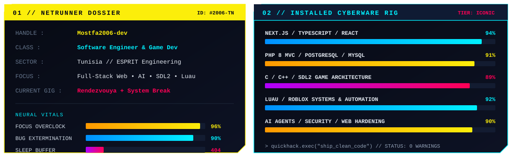

<div align="center">

<!-- HERO CYBERPUNK GLITCH HUD BANNER -->


<br/>

<!-- ANIMATED CYBERPUNK TERMINAL TYPING -->
<a href="https://github.com/Mostfa2006-dev">
  
</a>

<p>
  
  
  
  
</p>

</div>

---

<!-- CYBERWARE DOSSIER & SKILL RIG -->
<div align="center">
  
</div>

---

## `⚡ 03 // TECH ARSENAL & QUICKHACKS`

<div align="center">

**`[ LANGUAGES // NEURAL CORE ]`**


**`[ FRAMEWORKS // ENGINES // AI ]`**


**`[ DATABASES // INFRASTRUCTURE // OPS ]`**


</div>

---

<!-- FEATURED GIGS / MISSIONS -->
<div align="center">
  
</div>

<div align="center">
  <a href="https://github.com/Mostfa2006-dev/cyberpunk-system-break-flyer">
    
  </a>
  <a href="https://github.com/Mostfa2006-dev/luaforge">
    
  </a>
  <a href="https://github.com/Mostfa2006-dev/odysseus-mirror">
    
  </a>
  <a href="https://github.com/Mostfa2006-dev?tab=repositories">
    
  </a>
</div>

---

## `📡 04 // NIGHT CITY TELEMETRY`

<div align="center">

<a href="https://github.com/Mostfa2006-dev">
  
</a>

<br/><br/>

<a href="https://github.com/Mostfa2006-dev">
  
</a>

</div>

---

## `🎒 05 // CYBERDECK INVENTORY`

```text
╔════════════════════════════════════════════════════════════════════════╗
║  CYBERDECK SLOT // LOADOUT                                   STATUS    ║
╠════════════════════════════════════════════════════════════════════════╣
║  [01] ☕ OVERCLOCKED ESPRESSO        x∞                      [ACTIVE]  ║
║  [02] 🎧 NOISE-CANCEL OPTICS         MK.V                    [EQUIPPED]║
║  [03] 🎮 GAME ENGINE DEVKIT          C / SDL2 / LUAU         [READY]   ║
║  [04] 🧠 AI DAEMON SUITE             LLM • AUTOMATION        [ONLINE]  ║
║  [05] 🛡️ SECURITY ICE BREAKER        CSRF • PDO • RBAC       [ARMED]   ║
║  [06] 💤 SLEEP MODULE                ERR_404_NOT_FOUND       [OFFLINE] ║
╚════════════════════════════════════════════════════════════════════════╝
```

<details>
<summary><code>&gt; decrypt --log "dev_philosophy.dat"</code> (Click to expand)</summary>

```yaml
netrunner: Mostfa2006-dev
motto: "Break limits, ship clean systems, never stop upgrading the rig."
mission:
  - Build fast, secure, real-world web platforms (Next.js, TypeScript, PHP MVC)
  - Craft custom 2D/3D interactive experiences & game mechanics (SDL2, Luau)
  - Engineer practical AI assistants that actually solve human problems
status: "Always open to ambitious collabs & bold engineering gigs."
```

</details>

---

## `🔗 06 // JACK IN — DIRECT UPLINK`

<div align="center">

<a href="https://github.com/Mostfa2006-dev">
  
</a>
<a href="https://github.com/Mostfa2006-dev?tab=repositories">
  
</a>
<a href="https://github.com/Mostfa2006-dev?tab=stars">
  
</a>

<br/><br/>

<!-- ANIMATED NIGHT CITY TERMINAL SIGN-OFF -->


</div>
